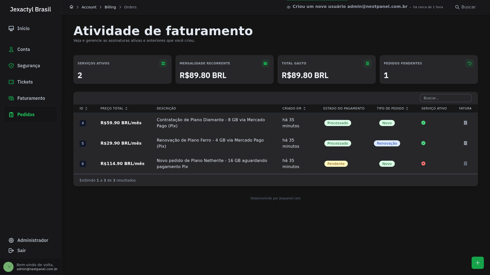
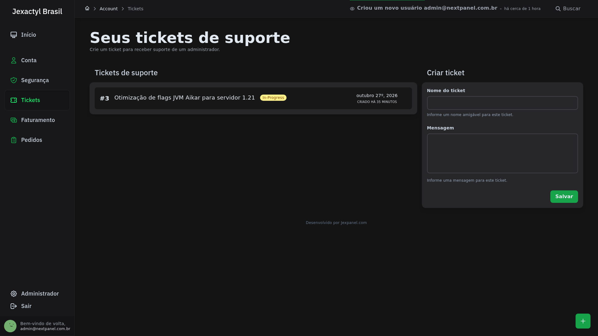
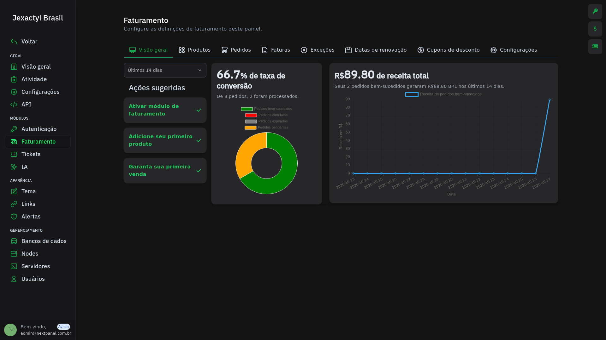
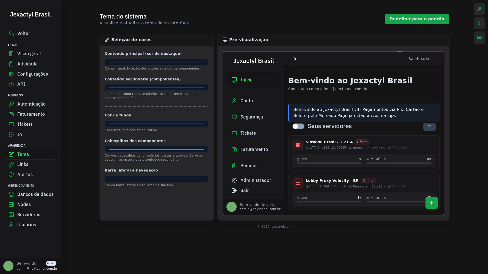

# Introdução ao Jexactyl Brasil

import Link from '@docusaurus/Link';

<h1 align="center">Jexactyl Brasil</h1>
<h5 align="center">
    <strong>
        Painel de gerenciamento de jogos e sistema de faturamento integrado — rápido, seguro e personalizável. 
        Dê aos seus usuários a vantagem em desempenho, confiabilidade e pura funcionalidade em Português do Brasil.
    </strong>
</h5>

:::danger Alerta Crítico de Segurança — Atualize da v3 imediatamente (PHP2Shell: CVE-2026-109618 / CVE-2026-109619)
Caso você ainda utilize o **Jexactyl v3.8.6** (ou anterior) ou execute o painel sobre versões antigas do PHP, **atualize imediatamente para a v4.0.7 e atualize o runtime do PHP no seu servidor**.

As vulnerabilidades críticas conhecidas como **PHP2Shell** (**CVE-2026-109618** e **CVE-2026-109619**, CVSS 9.2) afetam o interpretador PHP (versões 5.4 a 8.5 anteriores aos patches de segurança de outubro de 2026) por falhas de corrupção de memória (*Out-of-Memory `longjmp()`*) e *Use-After-Free* no *session upload progress*. Em painéis desatualizados, um atacante não autenticado pode ler a memória do processo (expondo `.env`, `APP_KEY`, credenciais do banco de dados e chaves de API) e executar código remotamente (RCE) no host do painel.
:::

---

## Escolha o Método de Instalação

Use o seletor no topo da página caso deseje alternar para a documentação legada (v3.8.6). Para a versão atual do painel, oferecemos dois métodos de instalação:

| Método de Instalação | Indicação | Guia Passo a Passo |
| :--- | :--- | :--- |
| **1. Via Docker — Recomendado** | Subida rápida usando a imagem oficial pré-compilada (`ghcr.io/next-panel/jexactyl-br:latest`) com MariaDB 11 e Redis integrados, sem precisar instalar PHP, Composer ou Node.js no host. Compatível com **Caddy** e **Nginx**. | [**Instalar via Docker (Recomendado) →**](/docs/Jexactyl/v4.x.x/docker/subida-rapida) |
| **2. Diretamente na Máquina (Host)** | Instalação clássica *bare-metal* em servidores Ubuntu 22.04/24.04 ou Debian 11/12 configurando PHP 8.4, MariaDB, Redis e servidor web diretamente no sistema operacional. | [**Instalar na Máquina (Host) →**](/docs/Jexactyl/v4.x.x/host/dependencias) |
| **3. Documentação Legada (`v3.8.6`)** | Apenas para consulta de ambientes antigos ainda em processo de migração. | [**Consultar v3.8.6 (Legado) →**](/docs/Jexactyl/v3.8.6/intro) |

---

## Por que usar o Jexactyl?

* **Faturamento integrado:** Venda servidores sob demanda com geração de faturas em PDF, cupons de desconto, renovações automáticas, upgrades de recursos e histórico de pedidos.
* **Autenticação moderna e segura:** Proteja contas com Passkeys (WebAuthn), autenticação em duas etapas (2FA), proteção JGuard, cargos administrativos com permissões granulares e login social via Discord e Google SSO.
* **Interface administrativa limpa e personalizável:** Gerencie módulos, edite temas com pré-visualização em tempo real, configure alertas globais e adicione links personalizados diretamente pelo painel.
* **Operação centralizada:** Sistema nativo de chamados (tickets) para clientes, integração com IA, presets de servidores, fila de aprovação de contas e webhooks de eventos.

## O que há de diferente em relação ao Jexactyl original?

* **Tradução completa para Português do Brasil:** Mais de 20 patches modulares cobrindo a interface do cliente, console de servidor, loja, autenticação, validações do Laravel, templates de e-mail e painel administrativo, preservando a precisão de termos técnicos de infraestrutura.
* **Gateway de Pagamento Mercado Pago Nativo:** Integração nativa com o **Mercado Pago (Checkout Pro)** para recebimento via **Pix** (com aprovação automática via webhook), **Cartão de Crédito/Débito** e **Boleto**, operando em arquitetura multiprovedor lado a lado com a **Stripe**.
* **Stack Docker Pronta para Produção:** Imagem Docker baseada em PHP 8.4 + Nginx + Supervisord acompanhada de `docker-compose.yml` com MariaDB 11 e Redis, realizando geração automática de `APP_KEY`, migrações, criação do usuário administrador e execução de filas/scheduler sem configuração manual complexa.

---

## Previews do Painel

| | |
| :---: | :---: |
| **Tela de Login**  | **Painel do Cliente e Servidores**  |
| **Loja de Planos**  | **Checkout (Mercado Pago e Stripe)**  |
| **Histórico de Pedidos e Assinaturas**  | **Sistema de Chamados (Tickets)**  |
| **Visão Geral do Administrador**  | **Métricas de Faturamento**  |
| **Provedores de Pagamento (Stripe e Mercado Pago)**  | **Editor de Temas em Tempo Real**  |
