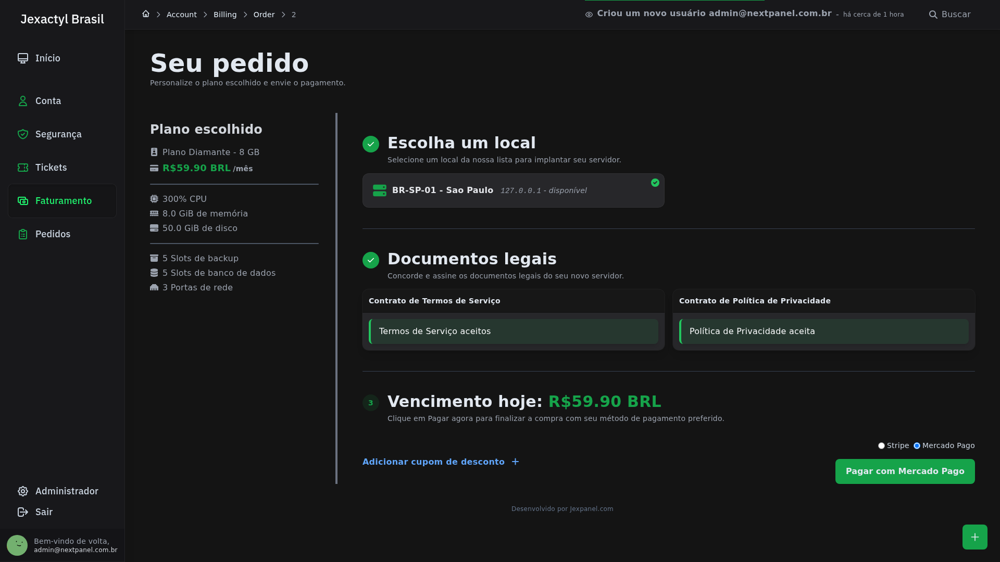

# Pagamentos com Mercado Pago

O **Jexactyl Brasil** possui um gateway nativo **Mercado Pago (Checkout Pro)** integrado diretamente ao módulo de faturamento de produtos e planos, operando lado a lado com a **Stripe**.

### Recursos suportados:
* **Pix (com aprovação automática via Webhook)**, **Cartão de Crédito/Débito** e **Boleto Bancário**.
* Contratação de novos servidores e renovações de planos na loja.
* Configuração direta pela interface administrativa (**Faturamento → Configurações**) ou via arquivo `.env`.

---

## 1. Obter o `Access Token` e `Webhook Secret` no Mercado Pago

1. Acesse o [Painel de Desenvolvedores do Mercado Pago](https://www.mercadopago.com.br/developers/panel/app) e clique em **Criar aplicação**.
2. Selecione **Checkout Pro** nas soluções integradas.
3. No menu lateral da aplicação criada, acesse **Credenciais de produção** (ou **Credenciais de teste** para homologação) e copie o seu **`Access Token`** (`APP_USR-...`).
4. No menu **Webhooks**, adicione a URL pública do seu painel:
   ```text
   https://painel.seudominio.com.br/mercadopago/webhook
   ```
   Marque o evento **Pagamentos (`payment`)** e copie a **Assinatura secreta (`Webhook Secret`)** gerada pelo Mercado Pago.

---

## 2. Configurar pela Interface Administrativa (ou `.env`)

No painel administrativo, acesse **Faturamento → Configurações**:


1. Na seção **Provedores de Pagamento**, clique em **Configurar** no card do **Mercado Pago**.
2. Insira o seu **`Access Token`** e o **`Segredo do Webhook`**.
3. Escolha o **Gateway Padrão** no seletor (`Mercado Pago` ou `Stripe`) e certifique-se de que a moeda do faturamento esteja configurada como **`BRL` (`R$`)**.

### Configuração via `.env` (Docker ou Host)

Você também pode definir as variáveis diretamente no `.env`:

```dotenv
BILLING_ENABLED=true
BILLING_GATEWAY=mercadopago
MP_ACCESS_TOKEN=APP_USR-seu-token-aqui
MP_WEBHOOK_SECRET=seu-segredo-webhook-aqui
MP_SANDBOX=false
```

:::info Ambiente de Homologação (Sandbox)
Durante testes com credenciais de teste do Mercado Pago, mantenha `MP_SANDBOX=true`. Em produção com clientes reais, defina `MP_SANDBOX=false`.
:::

---

## 3. Experiência no Checkout do Cliente

Quando ambos os provedores estão configurados (ou apenas o Mercado Pago), o cliente escolhe os recursos do servidor na loja e visualiza o seletor de pagamento:


